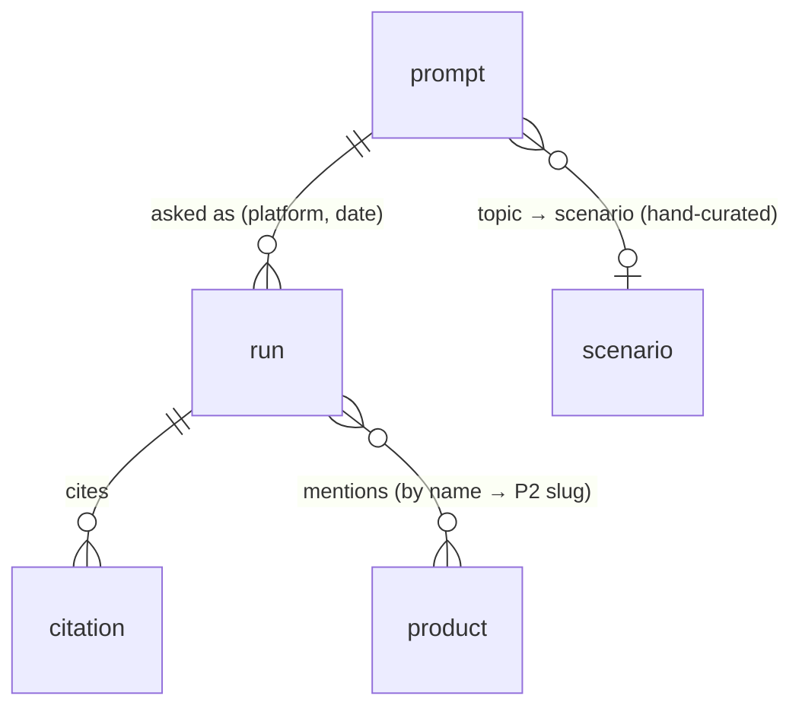
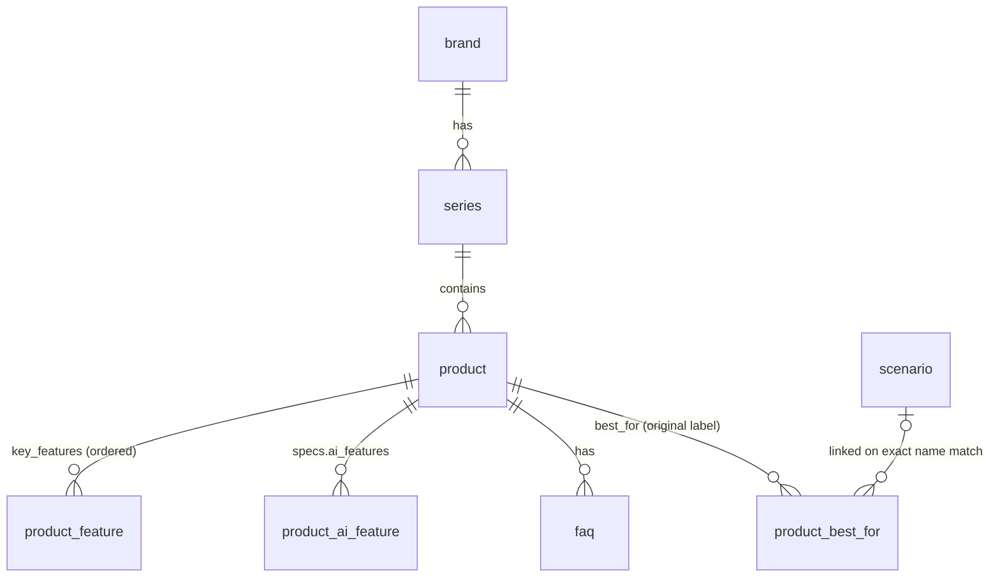

# geo-fe · AI Visibility Dashboard + 产品知识中心

万悉科技 AI 全栈工程师（前端方向）笔试。两道题放在同一个仓库、同一个 Next.js 服务里，按访问路径区分：

| 应用 | 入口 | 对应 Trendee 能力 |
|---|---|---|
| Project 1 · AI Visibility Dashboard | `/dashboard` | GEO 监控系统：AI 可见性监控、AI 信源分析、智能行动中心 |
| Project 2 · 产品知识中心 | `/products`（后台 `/admin/products`） | GEO 原生网站基建：JSON-LD 结构化数据、内部知识图谱、问答式搜索、内部信息关联增强 |

> Demo 录屏：（待补链接）

---

## 1. 运行方式

环境：Node ≥ 18.18、pnpm。不需要任何 API key。

```bash
pnpm i
pnpm dev          # 自动 seed SQLite 后启动 http://localhost:3000
```

| 命令 | 作用 |
|---|---|
| `pnpm dev` | 开发模式。先把 `data/` 里的 JSON 导入 SQLite（`.local/geo.db`），再起 Next.js |
| `pnpm demo` | seed → `next build` → `next start`。**演示「后台改内容 → 静态页与 JSON-LD 同步更新」请用这个**：dev 模式每次请求都现场渲染，看不出按需重新生成是否生效 |
| `pnpm test` | 后端单测（Vitest，59 条） |
| `pnpm typecheck` | 前端 `tsc --noEmit` |
| `pnpm lint` | ESLint（`next/core-web-vitals` + `next/typescript`），零警告才通过 |
| `pnpm e2e` | Playwright 冒烟测试（6 条）。自带生产构建，用独立的端口 3100、构建目录 `.next-e2e` 和数据库 `.local/e2e.db`，不影响正在跑的 `pnpm dev`。首次需 `pnpm exec playwright install chromium` |

CI（`.github/workflows/ci.yml`）依次跑 typecheck → lint → test → build → e2e，失败时上传 Playwright 报告。

**演示开关**：任一 Dashboard 页面加 `?simulate=slow | error | empty`，可当场切出 Loading / Error / Empty 三态（由 `DEMO_SIMULATE=0` 关闭）。

**better-sqlite3 装不上**：它是原生模块，常见平台有预编译包。若当前 Node 版本没有，会回退到本地编译（需要 Xcode Command Line Tools 或 build-essential）。seed 失败会打印原因并退出，不会静默。

---

## 2. 技术栈

| 层 | 选型 | 说明 |
|---|---|---|
| 框架 | Next.js 15（App Router）· React 19 · TypeScript strict | Node 18 上限是 Next 15 |
| 样式 | Tailwind CSS 3.4 | |
| 可视化 | ECharts 5 | 只在客户端组件里加载，卸载时 dispose |
| 类型与校验 | zod | 数据文件、接口出入参、后台表单共用一份 schema |
| 存储 | P1：只读 JSON；P2：SQLite（better-sqlite3）+ Drizzle ORM | |
| 测试 | Vitest · Playwright | 单测断言值取自对数据的人工核算；端到端覆盖三态、URL 筛选、后台保存后静态页与 JSON-LD 同步、保存失败、图表数据表、空场景不收录 |

---

## 3. 项目结构

pnpm workspace，代码分前后端两个目录，**运行时只有一个 Next.js 进程**。

```
geo-fe/
├── data/                        出题方提供的 7 个 JSON，原样保留
├── backend/                     @geo/backend：纯 TypeScript，不起服务、不依赖 next/*
│   └── src/
│       ├── shared/              路径、RFC 9457 错误体、?simulate= 开关
│       ├── dashboard/           P1：schema · repo（读 JSON）· metrics · insight · http
│       ├── db/                  P2：Drizzle 表定义 · 连接 · seed
│       └── knowledge/           P2：schema · repo · jsonld · ask · http
└── frontend/                    唯一的 Next.js 应用
    ├── app/
    │   ├── (dashboard)/         前端应用一：自己的根布局，noindex
    │   ├── (knowledge)/         前端应用二：自己的根布局，/products、/scenarios、/admin
    │   ├── api/                 每个 route.ts 只转发到 backend/*/http.ts
    │   ├── sitemap.ts · robots.ts · llms.txt/
    └── components/{dashboard,knowledge}/
```

### 接口

| 接口 | 说明 |
|---|---|
| `GET /api/dashboard/summary?platform=&intent=` | KPI、Prompt 覆盖率、平台对比、日趋势、Topic（附对应场景页）、意图分组、最该优化的 5 个 Prompt |
| `GET /api/dashboard/questions?platform&topic&intent&mentioned&recommended&q&page&pageSize` | 问题列表，服务端筛选与分页；附 `facets`（全量平台 / Topic / 意图） |
| `GET /api/dashboard/questions/:id` | 问题详情、同一 Prompt 的其他观测、引用域名分组、提到的产品与对应场景页（链到 P2） |
| `POST /api/dashboard/insight` | 规则版 AI Insight，body 为当前筛选 |
| `GET /api/knowledge/products?series&scenario` · `GET /api/knowledge/products/:slug` | 产品列表与详情 |
| `POST /api/knowledge/products` · `PUT /api/knowledge/products/:slug` | 后台新增与编辑，成功后触发页面重新生成 |
| `POST /api/knowledge/ask` | Ask AI，body `{ question, productSlug? }` |

参数错误返回 400，资源不存在返回 404，错误体统一为 RFC 9457（`application/problem+json`）。

```bash
curl 'localhost:3000/api/dashboard/questions?platform=DeepSeek&mentioned=false'   # total: 13
curl 'localhost:3000/api/dashboard/questions?platform=Foo'                        # 400
curl -X POST localhost:3000/api/knowledge/ask -H 'content-type: application/json' \
  -d '{"question":"Does Nova X8 support PoE?","productSlug":"nova-x8"}'           # conflict: true
```

### P1 数据模型

`questions.json` 的一行是一次**观测**（run）：某个 Prompt 在某个平台、某一天被问一次。120 行 = 32 个 Prompt × 3–4 次观测，其中 31 个 Prompt 有同一平台在不同日期被问两次。同一 Prompt 的 Topic 和意图 100% 一致，所以它们属于 Prompt。



数据没有 Prompt id，`prompt_id` 由规范化后的问题文本哈希派生（[repo.ts](backend/src/dashboard/repo.ts)）。行内业务规则（推荐必先提及、提到产品必算提及、`citation_count` = 引用条数）写在 zod 的 `superRefine` 里，数据漂移会在加载时报错，不只校验形状。

### P2 数据模型



---

## 4. 关键设计选择

每条写清「为什么 / 反方 / 什么时候换」。

**① 一个服务，前后端分目录，两个前端应用按路径区分**
- 为什么：评审只跑一条命令；`backend/` 不依赖 Next，`app/api` 只是一层转发，边界靠目录和依赖方向守住。两个前端应用是两个路由组，各有自己的根布局，彼此不共享外壳。
- 反方：「后端」不是独立进程，扩缩容和发布绑在一起。
- 何时换：API 有 Next 以外的调用方，或需要独立发布时，把 `backend/*/http.ts` 挂到 Hono / Fastify 上即可，前端调用路径不变。

**② 指标一律由问题明细重算，summary 文件只用来对账**
- Visibility = 被提及的问题数 ÷ 问题数，即提及率，页面上直接写明；Citations 71 是引用**条数**，另外标出只有 42 个问题有引用（35%）。
- 取整用「四舍六入五成双」：Claude 15/24 = 62.5，出题方汇总是 62。用 JS `Math.round` 会得到 63，单测对出题方汇总逐项比对时发现。
- 行是观测，内容按 Prompt 改，所以另算 **Prompt 覆盖率**（每次观测都提到品牌的 Prompt 数：32 个里 9 个），「最该优化」按 Prompt 去重、按最差一次观测排序，而不是按行。
- **自有来源按域名判定，不看 `source_type = Official`**：13 条 Official 引用里只有 1 条在 `astervision.example` 上；7 条自有域名引用里 Industry 3、Review 2、Media 1、Official 1。Official 是数据方的来源类别，「是否自有」要另算，混用会把自有占比算错。
- 意图类型（`intent_type`）进入筛选、分组和 Insight（A 类 60 题、提及率 65%，最低）。数据说明写的是 S/A/B/C，但本期没有 S 类，页面如实标注；数据没定义各类含义，所以只报差异，不解释原因。
- 反方：数据量小，直接读 summary 更省事。但数据源一旦换成真实明细，接口不用改。
- 何时换：明细到百万行以上时，改为在数据库或 OLAP 里按天、平台、Topic 预聚合，接口契约不变。

**③ AI Insight：规则算数，不让模型编数字**
- 5 条结论（短板平台、短板 Topic、提及未转推荐、被提及但缺引用、自有来源占比）都由明细算出，每条附一个可点开的证据链接（预置筛选的问题列表）。
- 反方：看起来没那么「AI」。但数字可复现、无 key 也能完整演示。
- 何时换：配置 LLM key 后，规则算出的数字作为上下文交给模型润色和延伸，输出后回查文中每个数字，对不上的标红；规则版保留为无 key 时的兜底。

**④ 产品页：静态生成 + 按需重新生成**
- 详情页和场景页用 `generateStaticParams` 预生成，后台保存后 `revalidatePath`。爬虫和 AI 抓取拿到的是完整 HTML。
- 反方：客户端渲染写起来更简单，但爬虫和 AI 读不到 JS 渲染的内容，等于这道题的立论不成立；另一个反方是「每次请求服务端渲染」，永远最新，但这类内容几乎不变，每次渲染是浪费。
- 何时换：产品数上万、一次编辑要重新生成的页面太多时，改为按标签（`revalidateTag`）精确失效，或加时间型 ISR 兜底。现在每次保存重新生成全部产品页（约 20 个），因为每个产品页都展示同系列产品。

**⑤ JSON-LD：一张 `@graph`，内容与页面可见内容同源，不编造**
- Organization（`@id`）、Product（`brand` 指向 Organization）、FAQPage、BreadcrumbList；场景页是 CollectionPage + ItemList。页面和 JSON-LD 由同一份数据渲染。
- **不补价格和评分**：数据里没有。Google 的 Product 富摘要需要 offers / review / aggregateRating 之一，所以 Rich Results Test 会对 Product 报缺字段。这里的 Product 标记用来**声明实体**，让 AI 系统理解「哪个品牌的哪款产品、有什么属性」，这正是 GEO 的价值所在。
- 反方：补一个 Mock 价格就能让 Rich Results Test 全绿。但结构化数据必须和页面可见内容一致，编造价格既违反 Google 的结构化数据政策，也违背「不改原始数据含义」。
- 何时换：有真实价格或评价数据时补上 `offers` / `aggregateRating`，争取富摘要。
- `dateModified` 同理：产品表有 `updated_at`，后台保存时写入，JSON-LD 和页面上的「Last updated」据此输出；导入的内容没有编辑时间，就不输出，不拿导入时间冒充修改时间。

**⑥ Ask AI：只依据知识库作答，资料冲突时明说**
- 关键词检索，「是否支持某功能」类问题优先查规格（数据里这类 FAQ 是答非所问的模板句）；查不到就明确说没有。
- 卖点与规格矛盾时两处都引用，提示「Sources disagree」，不替数据拍板。例：Nova 系列卖点写 PoE support，规格里 Nova X8 的连接方式却是 Ethernet。
- 入口融入产品：详情页默认限定当前产品，可切到全站；列表页是全站问答。
- 反方：向量检索对同义表达召回更好；把全部知识塞进提示词交给 LLM 也能答。但前者要嵌入模型或外部服务，评审跑不起来的风险上升；后者没有检索依据，引用无从标起。
- 何时换：知识条目上千、问法发散时上混合检索（关键词 + 向量），并用 LLM 生成、逐句标来源。

**⑦ 场景是实体，未匹配的 Best For 保留为标签**
- `best_for` 有 15 种取值，场景表只有 8 个。名称完全相同的才链接到场景实体（有自己的页面和 JSON-LD），其余原样保留。
- 反方：把 Small Retail 合并进 Retail、Multi-site Deployment 合并进 Multi-site，场景页会更饱满。但这改变了原始含义，数据说明不允许。
- 何时换：内容团队确认了场景分类后，在后台维护「标签 → 场景」映射表，由人来决定合并，而不是代码替数据决定。
- 同一原则用在 P1 → P2 的桥上：Topic 和场景名字从不完全相同（Warehouse Security / Warehouse），所以用一张人工映射表（[topic-scenario.ts](backend/src/dashboard/topic-scenario.ts)），6 个 Topic 有对应场景，Low-light Imaging（能力）和 Product Comparison（购买阶段）明确为无。看板上「最弱 Topic」和问题详情因此能直接指到该改的场景页，单测保证映射里的场景都真实存在。
- 没有任何产品的场景页（Multi-site：数据里写的是 Multi-site Deployment）仍可访问，但 `noindex`、不进 sitemap 和 llms.txt、不输出 JSON-LD：空页对 SEO 和 GEO 都是薄内容。

---

## 5. AI 工具使用说明

主要工具：Claude Code。

| 环节 | 怎么用 | 人的判断在哪 |
|---|---|---|
| 读题与数据摸底 | 让 AI 用脚本由明细重算全部汇总、检查 P2 关系完整性 | 定指标口径；决定 4 处数据不一致怎么处理（展示原样、Ask AI 明说冲突） |
| 方案与计划 | 先写任务拆解与实现计划（接口签名、测试真值、文件归属），再动手 | 单服务还是前后端两进程、SQLite 还是 JSON、规则还是 LLM 等取舍 |
| 实现 | 骨架自己搭；P1、P2 分给两个 AI 子代理并行实现，各自只能改自己名下的目录 | 每个模块先写失败测试，断言值是人工核过的真值（71 / 85 / 56、DeepSeek 46 等） |
| 验收 | 跑测试、类型检查、生产构建；用无头浏览器逐页点击、截图 | 不以「AI 说做完了」为准，以实测为准 |

提交后的三轮改进（前端工程、数据建模、质量设施）各有一份设计与实施计划，见 [docs/superpowers/](docs/superpowers/)。这些文档是**执行后补写**的（开头均有注明），随后由独立审查者逐条对照代码复核，发现的问题与修复记录在质量设施设计文档末尾。

**AI 出过的错，以及怎么发现的：**
1. **JSON-LD 漏了 Key features**：AI 写的 Product 结构化数据只放了规格。生产模式下实测「后台改一条 Feature」时发现页面变了、JSON-LD 没变。先补失败测试，再修。
2. **为绕开打包问题写了运行时 `require`**：better-sqlite3 只装在 backend 里，Next 无法把它当外部包处理，AI 的解法是在代码里手写运行时加载。合并时改成在 frontend 也声明这个依赖，让 `serverExternalPackages` 正常生效，代码回到普通 import。
3. **取整口径**：AI 起初用 `Math.round`，Claude 平台算出 63；对账测试与出题方汇总（62）不符，查出是五成双取整。

---

## 6. 不足，以及再给一周会先做什么

**当前不足**
- AI Insight 和 Ask AI 都是规则版，没有接真实 LLM；Ask AI 只支持英文提问，同义表达召回弱。
- 数据只有回答摘要（`answer_excerpt`），没有完整回答，详情页如实标为 Answer excerpt。
- 出题方数据是模板生成的：同系列 4 款产品卖点完全相同，卖点与规格有矛盾。页面原样展示，对 SEO 是近似重复内容。
- 后台没有登录，也不能编辑 FAQ；slug 改名不会生成 301 重定向。
- 趋势图没有日期范围选择（接口已支持 `from` / `to`）。
- 端到端只有 6 条冒烟用例，覆盖主路径，没有视觉回归和移动端。

**再给一周的优先级**
1. **接入 LLM，保留数字校验**：Insight 用规则算出的数字作为上下文让模型润色，输出后回查每个数字，对不上的标红；Ask AI 改为检索 + 生成，回答逐句标来源，检索得分过低时拒答。
2. **内容质量**：为每个产品补独有内容，解决卖点与规格矛盾，并在后台加「卖点与规格一致性」校验。这对 SEO 去重和 GEO 实体区分都是根本问题。
3. **后台补齐**：登录、FAQ 编辑、slug 改名自动 301、编辑历史。
4. **Dashboard 交互**：日期范围、平台对比切换、问题详情抽屉（拦截路由）。
5. **工程**：看板首屏改为服务端组件取数（筛选已全在 URL，迁移只是换取数位置）；端到端补移动端视口与视觉回归。
